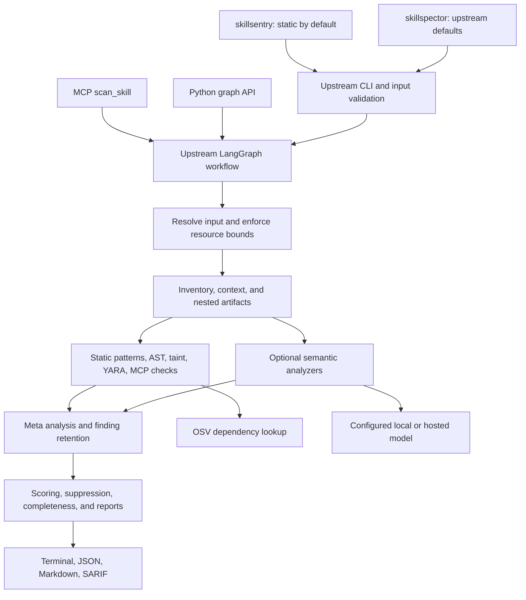

# Architecture and trust boundaries

The runtime architecture is inherited from NVIDIA SkillSpector. The new
`skillsentry` executable adapts CLI defaults only. It does not implement a
parallel scanner or change findings after the engine produces them.

## Implementation map

| Responsibility | Source |
| --- | --- |
| Independent command defaults | `src/skillsentry_foss/cli.py` |
| Compatibility CLI and exit policy | `src/skillspector/cli.py` |
| Graph construction and lazy package export | `graph.py`, `graph_proxy.py`, `__init__.py` |
| Input validation and materialization | `input_handler.py`, `nodes/resolve_input.py` |
| Artifact inventory and nested inspection | `artifacts.py`, `nested_artifacts.py`, `nodes/build_context.py` |
| Static and semantic analyzer registry | `nodes/analyzers/__init__.py` |
| Static rule definitions | `nodes/analyzers/pattern_defaults.py` |
| Python parsing and source mapping | `python_ast.py`, `python_tokens.py` |
| SQL parameter-binding proof | `nodes/analyzers/sql_parameter_binding.py` |
| MCP permission and tool checks | `nodes/analyzers/mcp_*.py`, `mcp_registry.py` |
| Provider selection and model controls | `providers/`, `llm_utils.py`, `model_info.py` |
| Completeness and coverage | `inspection_ledger.py`, `semantic_runtime.py` |
| Baselines and fingerprints | `suppression.py` |
| Reports and SARIF validation | `nodes/report.py`, `sarif_models.py` |
| Secure output and temporary cleanup | `file_output.py`, `cleanup.py` |
| Source snapshot verification | `scripts/verify_upstream.py`, `upstream-manifest.json` |

Paths without a prefix in the table are relative to `src/skillspector/`.
See the retained [development guide](../DEVELOPMENT.md) for graph state and
extension details, and [FEATURE_PARITY.md](FEATURE_PARITY.md) for the feature map.

## Input is untrusted

A skill can contain malicious prompts, scripts, Unicode confusables, deceptive
links, binary or nested payloads, poisoned metadata, and resource-exhaustion
inputs. The scanner reads artifacts for analysis; it does not execute scanned
skill scripts. The process still uses parsers, downloads, and Git as necessary.
Run scans under an account with limited privileges and avoid ambient secrets
when evaluating unknown content.

Preserve upstream limits on downloads, archives, nested members, workflow time,
findings, and completeness records. A truncated or unsupported artifact must
remain visible as incomplete analysis. The documented source snapshot check
prevents this fork from silently replacing the inherited engine with an
abbreviated implementation.

## Data egress depends on the entry point and options

| Operation | Data that can leave the host |
| --- | --- |
| Local static scan | OSV queries contain dependency coordinates when relevant |
| Remote source or transitive scan | Network requests to input and reference destinations |
| Semantic scan | Analyzer-eligible content sent to the configured model endpoint |
| LangSmith or other enabled tracing | Trace content according to the environment and runtime configuration |
| Agent CLI provider | Data sent and host access permitted by the chosen CLI runtime |

`--no-llm` disables model analysis. It is not an offline mode. OSV is free and
unauthenticated, but the network query is still egress. For a strict offline
deployment, preinstall dependencies, use local inputs, disable external tracing,
and enforce outbound restrictions outside the scanner. OSV falls back to its
bundled list when unreachable; this lowers vulnerability coverage.

The fork does not add a network-isolation mechanism. The upstream Codex CLI
provider remains disabled as documented upstream. It is not enabled by the fork.

## Findings and coverage are separate evidence

Static findings remain available when LLM review disagrees or fails. LLM review
can add context and confidence but does not prove safety. Baselines are an
operator policy decision that can suppress real findings. Assess their reasons
and exact fingerprints before use.

Risk scoring is inherited and heuristic. Do not interpret a score as a measured
probability of compromise. The inspection ledger records what was examined,
partially examined, skipped, or failed. A zero-finding report with incomplete
coverage must not be treated as a complete clean scan.

## Compatibility choices

The distribution remains `skillspector`, versioned
`2.12.0+skillsentry.1`. Both console commands are installed. Python imports,
`SKILLSPECTOR_*` variables, rule identifiers, JSON fields, SARIF tool identity,
Pi/OpenCode tool identifiers, and the MCP server remain compatible.
This deliberate identity reuse requires a separate virtual environment from
an independent upstream install. Repository branding and notices identify the fork.

The fork constructs a fresh Click command using Typer, then changes only the
`no_llm` defaults and adds the inverse `--llm` spelling for `scan` and `baseline`.
It retains the original callbacks, validation, and error handling. Tests check
that constructing it does not mutate upstream command defaults.

## Limits of provenance verification

The snapshot manifest records SHA-256 hashes of every tracked upstream file at
the pinned commit. UTF-8 text without NUL bytes is normalized from CRLF to LF;
other data is hashed unchanged. Documented packaging and documentation changes
are listed separately. No file under `src/skillspector/` can be exempted by that
list. Archived original documents and workflows are checked too.

This detects accidental drift against the committed manifest. The manifest is
not signed, and an attacker who controls the repository can replace the verifier
and manifest together. Establish source trust using the upstream commit and your
own reviewed Git history. This is not a software-signing or attestation system.
